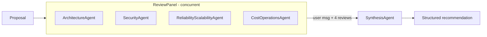

# AI Architecture Review Board — Implementation Plan

Demo for **Agentic .NET in Action: Microsoft Agent Framework, Aspire and Foundry**.
Status: **plan only, not implemented yet.**

## Goal

Accept a software architecture proposal, have four specialist agents review it **concurrently**, then pass their findings to a fifth **Synthesis Agent** in a **sequential** final stage that produces a structured recommendation (proposed design, rationale, trade-offs, risks, mitigations, open questions).

Stack: .NET 10, Microsoft Agent Framework (MAF), Aspire, DevUI, Microsoft Foundry.
Out of scope: RAG, tools, external integrations, custom UI, production hardening, `ArchitectureReviewer.Web` (left untouched, not in the solution).

## Existing scaffold

| Project | State |
| --- | --- |
| `ArchitectureReviewer.ApiService` | `Program.cs` is a stub, csproj has no packages. Hosts agents, workflows and DevUI. |
| `ArchitectureReviewer.AppHost` | Already adds a "DevUI Visual App" `/devui` link to the `apiservice` resource. |
| `ArchitectureReviewer.ServiceDefaults` | Standard Aspire defaults with OpenTelemetry and OTLP exporter wiring. |

## Reference samples (develop-agents repo)

- `section9-workflow-patterns/MinimalAgentWithWorkflows/WebApi/Program.cs`: `AddAIAgent`, `AddWorkflow(...).AddAsAIAgent()`, `AddDevUI`, `MapDevUI`, OpenAI Responses and Conversations.
- `section9-workflow-patterns/AgenticWorkflowPatterns`: `AgentWorkflowBuilder.BuildConcurrent` / `BuildSequential`, the proven Foundry client, and package versions.
- `section8-workflows`: `chatClient.AsAIAgent(name:, instructions:)`, and the explicit `WorkflowBuilder` / `BindAsExecutor` graph used as the fallback.

## Design

- `ReviewPanel`: concurrent workflow (`AgentWorkflowBuilder.BuildConcurrent`) over the four specialists. Its default aggregator returns the user message plus one assistant message per specialist.
- `ArchitectureReviewBoard`: sequential workflow `BuildSequential(ReviewPanel, SynthesisAgent)`. `ReviewPanel` is first as an agent (`AddAsAIAgent()`), so `SynthesisAgent` sees the proposal and all four reviews as conversation history.
- All agents share one `IChatClient` singleton.
- Both workflows are registered with `AddWorkflow(...).AddAsAIAgent()` so DevUI discovers them.

## Steps

1. **Packages** — `ArchitectureReviewer.ApiService.csproj`
   - `Azure.AI.OpenAI` 2.9.0-beta.1, `Azure.Identity` 1.21.0, `Microsoft.Agents.AI.OpenAI` 1.4.0 (brings `Microsoft.Agents.AI.Workflows`).
   - `Microsoft.Agents.AI.DevUI`, `Microsoft.Agents.AI.Hosting`, `Microsoft.Agents.AI.Hosting.OpenAI`: latest prerelease aligned to the 1.4.x line, resolved with `dotnet add package --prerelease`.
2. **Telemetry** (parallel with 1) — `ArchitectureReviewer.ServiceDefaults/Extensions.cs`
   - Mirror the working `MinimalAgentWithWorkflows/ServiceDefaults/Extensions.cs`.
   - `WithTracing`: add `.AddSource("*Microsoft.Extensions.AI")` and `.AddSource("*Microsoft.Extensions.Agents*")` after the existing `AddSource(ApplicationName)`. Wildcards also match the `Experimental.`-prefixed source names.
   - `ConfigureHttpClientDefaults`: replace the bare `AddStandardResilienceHandler()` with the LLM-friendly options (total timeout 5 min, attempt timeout 3 min, circuit-breaker sampling 6 min, 2 retries). The default 10 s attempt timeout would cut off the concurrent specialist and synthesis calls.
   - Existing OTLP exporter wiring stays unchanged.
3. **Program.cs** (depends on 1) — `ArchitectureReviewer.ApiService`
   - `AddServiceDefaults()`.
   - Shared client: `AzureOpenAIClient(new Uri(endpoint), new AzureCliCredential()).GetChatClient(deployment).AsIChatClient().AsBuilder().UseOpenTelemetry(c => c.EnableSensitiveData = true).Build()`, registered as a singleton.
   - Settings from `AZURE_OPENAI_ENDPOINT` (no hardcoded fallback) and `AZURE_OPENAI_DEPLOYMENT_NAME` (default `gpt-5-mini`).
   - Four specialists via `AddAIAgent` with `chatClient.AsAIAgent(name:, instructions:)`, each with a short single-purpose instruction block and a description: `ArchitectureAgent`, `SecurityAgent`, `ReliabilityScalabilityAgent`, `CostOperationsAgent`.
   - `ReviewPanel` via `AddWorkflow` + `BuildConcurrent`, then `.AddAsAIAgent()`.
   - `SynthesisAgent`: instructions require the sections Proposed Design, Rationale, Trade-offs, Risks, Mitigations, Open Questions, plus how conflicting opinions were resolved.
   - `ArchitectureReviewBoard` via `AddWorkflow` + `BuildSequential(ReviewPanel, SynthesisAgent)`, then `.AddAsAIAgent()`.
   - `AddDevUI`, `AddOpenAIResponses`, `AddOpenAIConversations`; map `MapDevUI`, `MapOpenAIResponses`, `MapOpenAIConversations`, `MapDefaultEndpoints`.
4. **AppHost** (parallel with 3) — `ArchitectureReviewer.AppHost/AppHost.cs`
   - Keep the existing `/devui` URL.
   - Forward `AZURE_OPENAI_ENDPOINT` and `AZURE_OPENAI_DEPLOYMENT_NAME` to `apiservice` with `WithEnvironment`.
5. **Verify**
   - `dotnet build ArchitectureReviewer.slnx` succeeds.
   - Run the AppHost, open DevUI, confirm `ArchitectureReviewBoard`, `ReviewPanel` and all agents are listed.
   - Run `ArchitectureReviewBoard` with a sample proposal: four reviews run concurrently, synthesis runs afterwards, output contains all six sections.
   - Aspire dashboard shows traces for chat and agent spans.

## Decisions and risks

- **Composition risk**: exposing a concurrent workflow as an agent and chaining it in `BuildSequential` must be confirmed on the installed 1.4.x packages. **Fallback**: explicit `WorkflowBuilder` graph with fan-out to the four agents, a fan-in aggregator executor (`BindAsExecutor`), then `SynthesisAgent`; DevUI would render it as a graph.
- **Auth**: `AzureCliCredential` (requires `az login`) for development only.
- **Package versions**: DevUI, Hosting and Hosting.OpenAI are previews, so versions must be aligned at install time. The `WebApi` sample uses 1.3.x previews.
- **DevUI** is a development sample app, not for production use.

## Sample proposal for the demo

"Migrate our monolithic e-commerce platform to microservices on AKS with an event-driven backbone on Azure Service Bus, a separate PostgreSQL database per service, and a single Azure Front Door entry point across two regions."
