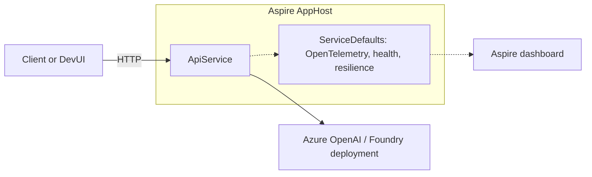
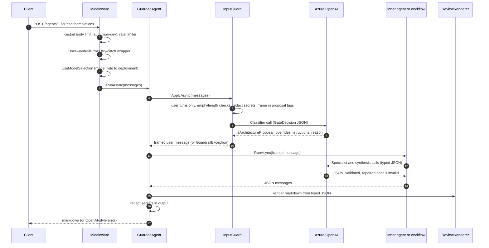
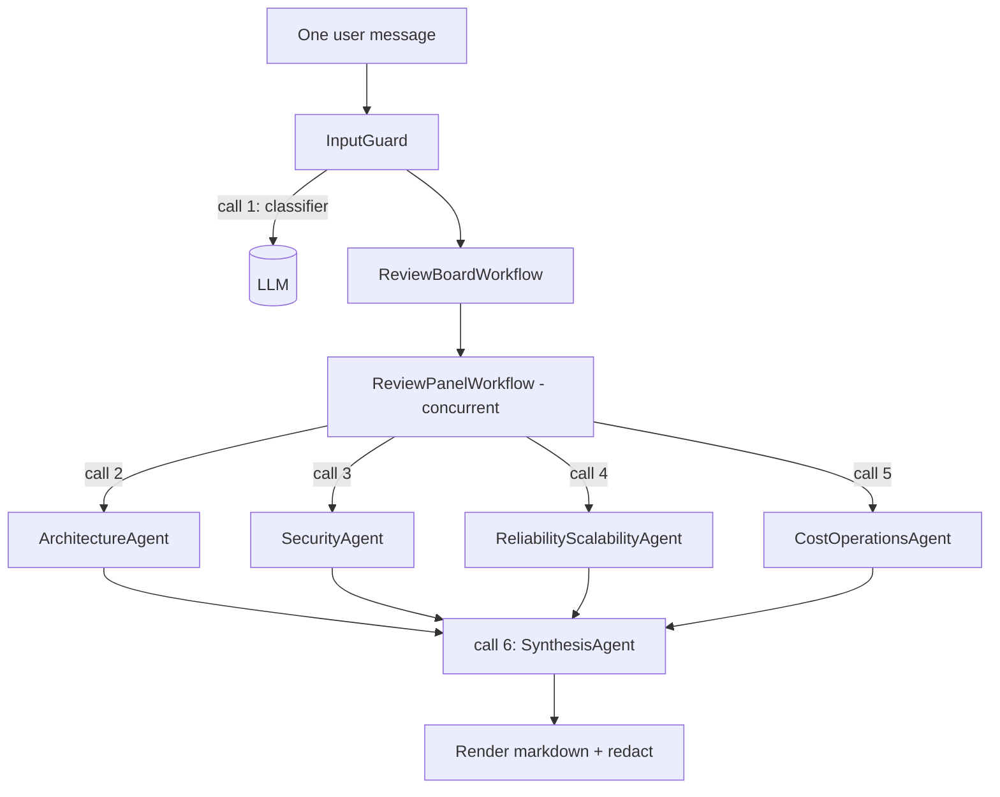
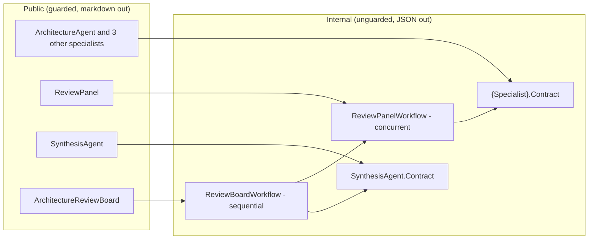
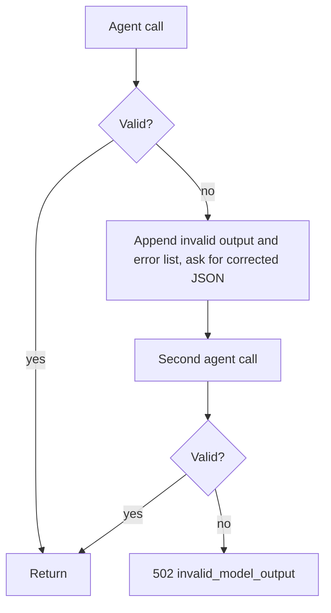

# Architecture and guardrails

How a request travels through the Architecture Reviewer, which guardrails it passes, and why one user message results in more than one LLM call.

## Read this first

- A request to a public agent (`ArchitectureAgent`, `ArchitectureReviewBoard`, ...) goes through **one** guard and then the agent or workflow.
- The guard itself calls the LLM once (the **intake classifier**) before any review starts. That is why a single specialist costs **2 calls**, not 1.
- Inside the workflows the specialists run behind no guard, so the classifier is **not** repeated per specialist.
- A repair retry adds one call per agent, only when its first output fails validation.

| Entry point | Typical LLM calls | Worst case |
| --- | --- | --- |
| `ArchitectureAgent` (or any single specialist) | 2 (classifier + specialist) | 3 |
| `ReviewPanel` | 5 (classifier + 4 specialists in parallel) | 9 |
| `ArchitectureReviewBoard` | 6 (classifier + 4 specialists in parallel + synthesis) | 11 |

Worst case for the board: 1 classifier + 4 specialists, each repaired once (8) + synthesis repaired once (2). Setting `Guardrails:EnableClassifier` to `false` removes the classifier call (see [Tuning cost and latency](#tuning-cost-and-latency)).

## Components



| Project | Responsibility |
| --- | --- |
| `ArchitectureReviewer.ApiService` | Agents, workflows, guardrails, endpoints, DevUI (development only) |
| `ArchitectureReviewer.AppHost` | Runs `apiservice`, forwards `AZURE_OPENAI_ENDPOINT` and `AZURE_OPENAI_DEPLOYMENT_NAME`, adds the DevUI link |
| `ArchitectureReviewer.ServiceDefaults` | OpenTelemetry, health checks, service discovery, HTTP resilience |

## Request pipeline

Order matches [Program.cs](ArchitectureReviewer.ApiService/Program.cs).



## Guardrail layers

| # | Layer | Where | Config | Failure |
| --- | --- | --- | --- | --- |
| 1 | Request body size cap | Kestrel in [Program.cs](ArchitectureReviewer.ApiService/Program.cs) | `MaxRequestBodyBytes` (64 KB) | 413 from Kestrel |
| 2 | JWT auth (non-development) | [AuthSetup.cs](ArchitectureReviewer.ApiService/Setup/AuthSetup.cs) | `AzureAd:TenantId`, `AzureAd:Audience` | 401 |
| 3 | Rate limit on `POST /agents/*`, per caller (`oid`, then name identifier, then IP, then `anonymous`) | [RateLimitingSetup.cs](ArchitectureReviewer.ApiService/Setup/RateLimitingSetup.cs) | `RequestsPerMinute` (10) | 429 |
| 4 | Model allow-list | [ModelSelectionMiddleware.cs](ArchitectureReviewer.ApiService/Middleware/ModelSelectionMiddleware.cs) | `AZURE_OPENAI_ALLOWED_DEPLOYMENTS` | 400 `model not available` |
| 5 | Only `user` turns are used, so caller-supplied system or assistant turns cannot smuggle instructions | [InputGuard.cs](ArchitectureReviewer.ApiService/Guardrails/InputGuard.cs) | none | 400 `empty_input` |
| 6 | Input length cap | `InputGuard` | `MaxInputChars` (8,000) | 400 `input_too_long` |
| 7 | Secret and PII redaction (keys, JWTs, connection-string secrets, SAS signatures, emails) | `Redactor` in [Guardrails.cs](ArchitectureReviewer.ApiService/Guardrails/Guardrails.cs) | none | value replaced, not rejected |
| 8 | `<proposal>` framing; a caller-supplied `<proposal>` or `</proposal>` tag is rewritten to `[proposal]` | `InputGuard` | none | none |
| 9 | LLM intake classifier (structured output, 1,000 output tokens) | `InputGuard.ClassifyAsync` | `EnableClassifier` (true) | 400 `prompt_injection`, 400 `not_an_architecture_proposal`, 503 `guardrail_unavailable` |
| 10 | Untrusted-input rule in every agent's instructions | [AgentSetup.cs](ArchitectureReviewer.ApiService/Setup/AgentSetup.cs) | none | none |
| 11 | Output token caps | `CreateContractAgent` | `SpecialistMaxOutputTokens` (4,000), `SynthesisMaxOutputTokens` (6,000) | truncated output fails the contract |
| 12 | Typed JSON contract (JSON schema response format, non-null required members) | [ReviewContracts.cs](ArchitectureReviewer.ApiService/Contracts/ReviewContracts.cs) | none | parse failure |
| 13 | Referential-integrity validation and one repair retry | `ContractValidatingAgent` + [ReviewValidator.cs](ArchitectureReviewer.ApiService/Contracts/ReviewValidator.cs) | none | 502 `invalid_model_output` |
| 14 | Markdown rendered in code, then output redaction | `GuardedAgent`, [ReviewRenderer.cs](ArchitectureReviewer.ApiService/Contracts/ReviewRenderer.cs) | none | 502 `invalid_model_output` if no valid contract |
| 15 | Azure content-filter blocks mapped to a clean error | [GuardrailErrorMiddleware.cs](ArchitectureReviewer.ApiService/Middleware/GuardrailErrorMiddleware.cs) | none | 400 `content_filter` |

## Why the LLM is called more than once

The classifier is a separate, small call because the specialists must never see an off-topic or hostile prompt, and because a cheap structured yes/no is easier to verify than relying on four agents to refuse independently.



Facts that explain the counts:

- The guard is applied by `GuardedAgent`, which wraps **public** agents only. Workflows are built from the internal `.Contract` agents (see `AgentNames.ContractKey`), which have no guard.
- Each contract agent is wrapped by `ContractValidatingAgent`. It calls its inner agent, validates, and on violations sends the invalid output plus the error list back for one more attempt (session reset to `null`). A second failure raises `invalid_model_output`.
- The classifier and the agents use the same routed `IChatClient`, so the `model` selected in the request applies to all calls of that request.
- The classifier does not retry. If the response cannot be parsed, the request fails with 503.
- Streaming requests are buffered: output is only valid after the whole contract is checked, so the final markdown is emitted in a single update.

### DevUI path

DevUI lists the public agents (`ArchitectureAgent`, `SecurityAgent`, `ReliabilityScalabilityAgent`, `CostOperationsAgent`, `ReviewPanel`, `SynthesisAgent`, `ArchitectureReviewBoard`). Each one carries its own guard, so every run of any of them performs one classifier call first. Running `ReviewPanel` and then `SynthesisAgent` by hand therefore classifies twice. The raw workflows (`ReviewPanelWorkflow`, `ReviewBoardWorkflow`) are unguarded and exist for the graph view.

## Agents and workflows



| Name | Kind | Role |
| --- | --- | --- |
| `ArchitectureAgent`, `SecurityAgent`, `ReliabilityScalabilityAgent`, `CostOperationsAgent` | Specialists | Each reviews one domain only and returns `SpecialistReview` JSON |
| `SynthesisAgent` | Chair | Merges the reviews into `ArchitectureRecommendation` JSON |
| `ReviewPanelWorkflow` | Concurrent workflow | `AgentWorkflowBuilder.BuildConcurrent` over the four `.Contract` specialists |
| `ReviewBoardWorkflow` | Sequential workflow | `BuildSequential(ReviewPanelWorkflow, SynthesisAgent.Contract)` |
| `ReviewPanel`, `ArchitectureReviewBoard` | Public wrappers | `GuardedAgent` around the workflows |

HTTP endpoints for Chat Completions are mapped for `ArchitectureAgent` (`/agents/architecture/v1/chat/completions`) and `ArchitectureReviewBoard` (`/agents/review-board/v1/chat/completions`). In development the OpenAI Responses and Conversations endpoints and DevUI are also mapped.

## Contracts, validation and rendering

The model returns JSON, never prose. Markdown is produced by `ReviewRenderer`, so the shape of the final answer cannot drift.

| Contract | Produced by | Key rules checked by `ReviewValidator` |
| --- | --- | --- |
| `SpecialistReview` | Each specialist | Unique non-empty finding ids; title and rationale present; every recommendation action present and only referencing known finding ids |
| `ArchitectureRecommendation` | `SynthesisAgent` | Design and rationale present; at least one trade-off and one risk; unique risk ids; each risk names who raised it and only domains that actually reviewed; every mitigation references a known risk; every risk has a mitigation |

Repair flow:



## Model routing and auth

- `ModelSelectionMiddleware` reads the request's `model` field without consuming the body, checks it against the allow-list (the default deployment plus `AZURE_OPENAI_ALLOWED_DEPLOYMENTS`), and stores it in `HttpContext.Items`.
- `ModelRoutingChatClient` resolves the deployment per call from that item, or the default (`AZURE_OPENAI_DEPLOYMENT_NAME`, falling back to `gpt-6-luna`). Each deployment client is cached and wrapped with OpenTelemetry.
- Azure OpenAI auth is `AzureCliCredential` in development (needs `az login`) and managed identity otherwise. Inbound auth is JWT bearer outside development.

## Errors

Guardrail rejections and content-filter blocks on `/agents/*` are returned as OpenAI-style errors:

```json
{ "error": { "message": "...", "type": "invalid_request_error", "code": "prompt_injection" } }
```

| Code | Status | Cause |
| --- | --- | --- |
| `empty_input` | 400 | No user text |
| `input_too_long` | 400 | Over `MaxInputChars` |
| `prompt_injection` | 400 | Classifier flagged an attempt to change behavior or reveal instructions |
| `not_an_architecture_proposal` | 400 | Classifier judged the input off-topic |
| `content_filter` | 400 | Blocked by the Azure content filter |
| `guardrail_unavailable` | 503 | Classifier response could not be parsed |
| `invalid_model_output` | 502 | Output still invalid after one repair, or no valid contract to render |
| (rate limit) | 429 | Over `RequestsPerMinute` |

## Observability

- `GuardrailMetrics` exposes the counter `guardrail.decisions` on meter `ArchitectureReviewer.Guardrails`, tagged `guard` and `outcome`.

| `guard` | `outcome` values |
| --- | --- |
| `empty`, `length` | `rejected` |
| `redaction` | `redacted` |
| `classifier` | `rejected` |
| `input` | `allowed` |
| `contract` | `valid`, `repair`, `invalid` |
| `output` | `allowed`, `redacted`, `invalid_contract` |

- Each LLM call is a span from the `Microsoft.Extensions.AI` source, tagged with the routed model. Counting those spans under one request trace gives the call budget above. Sensitive data capture is enabled in development only.
- A rising `contract/repair` count means the specialists or synthesis often produce invalid output, and each repair costs an extra call.

## Configuration

`Guardrails` section (see `GuardrailOptions` in [Guardrails.cs](ArchitectureReviewer.ApiService/Guardrails/Guardrails.cs)):

| Key | Default | Notes |
| --- | --- | --- |
| `MaxInputChars` | 8000 | Applied after joining user turns |
| `MaxRequestBodyBytes` | 65536 | Kestrel limit |
| `EnableClassifier` | `true` | Turns the intake LLM call on or off |
| `SpecialistMaxOutputTokens` | 4000 | Per specialist call |
| `SynthesisMaxOutputTokens` | 6000 | Per synthesis call |
| `Temperature` | unset | Unset on purpose: reasoning deployments reject a temperature override |
| `RequestsPerMinute` | 10 | Fixed window per caller, no queue |

Other settings: `AZURE_OPENAI_ENDPOINT` (required), `AZURE_OPENAI_DEPLOYMENT_NAME`, `AZURE_OPENAI_ALLOWED_DEPLOYMENTS`, `AZURE_CLIENT_ID`, `AzureAd:TenantId`, `AzureAd:Audience`.

## Tuning cost and latency

- `EnableClassifier=false`: a single specialist drops to 1 call and the board to 5. Deterministic checks (length cap, redaction, framing, untrusted-input rule, output contract) stay on, but off-topic and injection screening by the LLM is lost.
- Lower `SpecialistMaxOutputTokens` and `SynthesisMaxOutputTokens` to cap cost, but too low a value truncates JSON and triggers repairs.
- Specialists run in parallel, so board latency is roughly classifier + slowest specialist + synthesis.
- The 10 s default HTTP timeout is too short for these calls; the resilience handler is configured with long timeouts in `ServiceDefaults`.

## Out of scope

RAG, tools, external integrations and a custom UI. DevUI is a development tool and must not be exposed in production.
