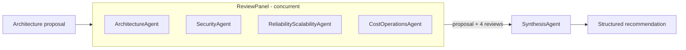
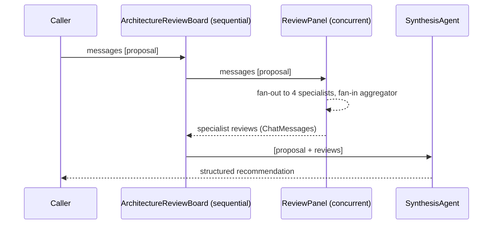

# AI Architecture Review Board

Demo for the .NET event session **"Agentic .NET in Action: Microsoft Agent Framework, Aspire and Foundry"**.

You submit a software architecture proposal. Four specialist AI agents review it **concurrently**. A fifth agent, the **Synthesis Agent**, then merges their findings **sequentially** into one structured recommendation.

| | |
| --- | --- |
| Runtime | .NET 10 |
| Agents and workflows | [Microsoft Agent Framework](https://learn.microsoft.com/agent-framework/) (MAF) |
| Orchestration and observability | .NET Aspire (dashboard, OpenTelemetry) |
| Models | Azure OpenAI / Microsoft Foundry (default deployment `gpt-5-mini`) |
| Dev UI | MAF DevUI |

> The solution is intentionally small. There is no RAG, no tools, no external integrations and no custom UI. The goal is to show the agent and workflow concepts clearly.

## What you will see in the demo

1. Four narrow, single-purpose agents (about 5 lines of instructions each).
2. A **concurrent** workflow that fans the proposal out to all four specialists.
3. A **sequential** workflow that chains the concurrent panel into the Synthesis Agent.
4. A workflow exposed as an agent, so workflows can be nested and composed.
5. DevUI to run and inspect agents and workflows visually.
6. Aspire dashboard traces for every chat call and agent step.

## Architecture



`ArchitectureReviewBoard` is the entry point. It is a sequential workflow: `ReviewPanel` first, then `SynthesisAgent`.

### Agents

| Agent | Scope |
| --- | --- |
| `ArchitectureAgent` | Service boundaries, coupling, data ownership, integration patterns |
| `SecurityAgent` | Identity, network exposure, data protection, secrets, compliance |
| `ReliabilityScalabilityAgent` | Availability, failure modes, scaling, disaster recovery |
| `CostOperationsAgent` | Cost drivers, operational complexity, observability, team readiness |
| `SynthesisAgent` | Merges the four reviews and resolves conflicts |

Each specialist stays inside its own scope and answers with **Strengths, Concerns, Recommendations** in under 250 words. This keeps the reviews focused and the outputs easy to compare.

### Workflows

| Workflow | Pattern | Built with |
| --- | --- | --- |
| `ReviewPanel` | Concurrent (fan-out / fan-in) | `AgentWorkflowBuilder.BuildConcurrent` |
| `ArchitectureReviewBoard` | Sequential | `AgentWorkflowBuilder.BuildSequential(ReviewPanel, SynthesisAgent)` |

The default concurrent aggregator returns the user message plus one assistant message per specialist. `SynthesisAgent` therefore sees the proposal and all four reviews as conversation history.

### Synthesis output

The Synthesis Agent always returns these sections:

- Proposed Design
- Rationale
- Trade-offs
- Risks
- Mitigations
- Open Questions

When specialists disagree, it states the conflict and explains how and why it resolved it.

## Solution layout

```text
ArchitectureReviewer/
├── ArchitectureReviewer.slnx
├── ArchitectureReviewer.AppHost/         Aspire orchestration
├── ArchitectureReviewer.ApiService/      Agents, workflows, DevUI, OpenAI-compatible endpoints
└── ArchitectureReviewer.ServiceDefaults/ OpenTelemetry, health checks, service discovery, resilience
```

| Project | Responsibility |
| --- | --- |
| `ApiService` | All agent wiring lives in [Program.cs](ArchitectureReviewer/ArchitectureReviewer.ApiService/Program.cs). It exposes DevUI, dedicated Chat Completions endpoints for `ArchitectureAgent` and `ArchitectureReviewBoard`, and the OpenAI Responses and Conversations endpoints. Sample requests are in the `.http` file next to it. |
| `AppHost` | Starts `apiservice`, forwards the Azure OpenAI settings to it and adds a **DevUI Visual App** link in the Aspire dashboard. See [AppHost.cs](ArchitectureReviewer/ArchitectureReviewer.AppHost/AppHost.cs). |
| `ServiceDefaults` | Shared telemetry and resilience setup. See [Extensions.cs](ArchitectureReviewer/ArchitectureReviewer.ServiceDefaults/Extensions.cs). |

## Key code walkthrough

### One shared chat client

All agents share a single `IChatClient` singleton with OpenTelemetry enabled.

```csharp
IChatClient chatClient = new AzureOpenAIClient(new Uri(endpoint), new AzureCliCredential())
    .GetChatClient(deploymentName)
    .AsIChatClient()
    .AsBuilder()
    .UseOpenTelemetry(configure: c => c.EnableSensitiveData = true)
    .Build();
builder.Services.AddSingleton(chatClient);
```

### Registering a specialist

Agents are registered with `AddAIAgent`, so DevUI and the workflows can resolve them by name.

```csharp
builder.AddAIAgent(agentName, (sp, name) => new ChatClientAgent(
    chatClient: sp.GetRequiredService<IChatClient>(),
    instructions: instructions,
    name: name,
    description: description,
    ...));
```

### Concurrent panel exposed as an agent

```csharp
builder.AddWorkflow("ReviewPanel", (sp, name) =>
{
    var specialists = new[] { "ArchitectureAgent", "SecurityAgent", "ReliabilityScalabilityAgent", "CostOperationsAgent" }
        .Select(n => sp.GetRequiredKeyedService<AIAgent>(n));

    return AgentWorkflowBuilder.BuildConcurrent(name, specialists);
}).AddAsAIAgent();
```

### Sequential board

```csharp
builder.AddWorkflow("ArchitectureReviewBoard", (sp, name) =>
{
    var reviewPanel = sp.GetRequiredKeyedService<AIAgent>("ReviewPanel");
    var synthesisAgent = sp.GetRequiredKeyedService<AIAgent>("SynthesisAgent");

    return AgentWorkflowBuilder.BuildSequential(name, reviewPanel, synthesisAgent);
}).AddAsAIAgent();
```

### Telemetry and resilience

In `ServiceDefaults`:

- Tracing adds the `*Microsoft.Extensions.AI` and `*Microsoft.Extensions.Agents*` activity sources, so chat and agent spans appear in the Aspire dashboard.
- The HTTP resilience handler uses LLM-friendly timeouts (5 min total, 3 min per attempt, 2 retries). The default 10 second timeout would cut off the agent calls.

## Prerequisites

- [.NET 10 SDK](https://dotnet.microsoft.com/download)
- [Aspire](https://aspire.dev) tooling (the AppHost uses `Aspire.AppHost.Sdk` 13.6.1)
- [Azure CLI](https://learn.microsoft.com/cli/azure/install-azure-cli), signed in with `az login`
- An Azure OpenAI or Microsoft Foundry resource with a chat model deployment (default name `gpt-5-mini`)
- Your identity needs access to the model, for example the **Cognitive Services OpenAI User** role

## Configuration

| Setting | Required | Default | Description |
| --- | --- | --- | --- |
| `AZURE_OPENAI_ENDPOINT` | Yes | none | Endpoint of your Azure OpenAI / Foundry resource |
| `AZURE_OPENAI_DEPLOYMENT_NAME` | No | `gpt-5-mini` | Model deployment name |

The AppHost reads both values from its configuration and forwards them to `apiservice`. Keep your endpoint out of source control by using user secrets:

```powershell
cd ArchitectureReviewer/ArchitectureReviewer.AppHost
dotnet user-secrets set "AZURE_OPENAI_ENDPOINT" "https://<your-resource>.services.ai.azure.com"
dotnet user-secrets set "AZURE_OPENAI_DEPLOYMENT_NAME" "gpt-5-mini"
```

Alternatively, set them as environment variables or in `appsettings.Development.json` (do not commit real values).

> Authentication uses `AzureCliCredential`. This is for **local development only** and requires `az login`.

## Run it

```powershell
az login
dotnet build ArchitectureReviewer/ArchitectureReviewer.slnx
dotnet run --project ArchitectureReviewer/ArchitectureReviewer.AppHost
```

Then, in the Aspire dashboard:

1. Open the `apiservice` resource.
2. Click the **DevUI Visual App** link (the `/devui` path).
3. Pick `ArchitectureReviewBoard` and paste the sample proposal below.

### Sample proposal

> Migrate our monolithic e-commerce platform to microservices on AKS with an event-driven backbone on Azure Service Bus, a separate PostgreSQL database per service, and a single Azure Front Door entry point across two regions.

### Expected result

- The four specialists run in parallel and each returns Strengths, Concerns and Recommendations.
- The Synthesis Agent runs after them and returns the six sections listed above.
- In the Aspire dashboard **Traces** view, you can see the concurrent chat calls and the final synthesis call.

Try running `ReviewPanel` or a single specialist from DevUI to compare the individual outputs.

## HTTP endpoints

`apiservice` exposes:

| Path | Purpose |
| --- | --- |
| `/devui` | DevUI for exploring and running agents and workflows |
| `POST /agents/architecture/v1/chat/completions` | OpenAI Chat Completions endpoint for `ArchitectureAgent` (single specialist) |
| `POST /agents/review-board/v1/chat/completions` | OpenAI Chat Completions endpoint for `ArchitectureReviewBoard` (full review plus synthesis) |
| OpenAI Responses and Conversations | OpenAI-compatible APIs mapped with `MapOpenAIResponses` and `MapOpenAIConversations` |
| `/health`, `/alive` | Health checks (Development only) |

The two dedicated endpoints are mapped in [Program.cs](ArchitectureReviewer/ArchitectureReviewer.ApiService/Program.cs) with `MapOpenAIChatCompletions`:

```csharp
app.MapOpenAIChatCompletions(architectureAgent, "/agents/architecture/v1/chat/completions");
app.MapOpenAIChatCompletions(reviewBoard, "/agents/review-board/v1/chat/completions");
```

They accept standard Chat Completions requests (including `"stream": true`), so any OpenAI client can call them. The `model` field is not used for routing here; the path selects the agent.

### Try the endpoints

Open [ArchitectureReviewer.ApiService.http](ArchitectureReviewer/ArchitectureReviewer.ApiService/ArchitectureReviewer.ApiService.http) in VS Code (REST Client or the built-in HTTP support) with the AppHost or `ApiService` running. It contains ready-made requests for:

- the health check,
- `ArchitectureAgent`,
- `ArchitectureReviewBoard`, with and without streaming.

The `@ApiService_HostAddress` variable defaults to `http://localhost:5344` (the `ApiService` launch profile). When you start through Aspire, copy the `apiservice` URL from the dashboard instead.

Example with `curl`:

```powershell
curl -X POST http://localhost:5344/agents/review-board/v1/chat/completions `
  -H "Content-Type: application/json" `
  -d '{"model":"ArchitectureReviewBoard","messages":[{"role":"user","content":"Migrate our monolith to microservices on AKS."}]}'
```

## Talking points for the session

- **Narrow agents beat generic ones.** Short, single-purpose instructions give more predictable results.
- **Workflows are agents.** `AddAsAIAgent()` lets you nest a workflow inside another workflow.
- **Concurrent then sequential.** Fan-out for independent opinions, then a single chair to reconcile them.
- **Observability from day one.** Aspire and OpenTelemetry make agent behavior visible without extra code.
- **DevUI for fast inner loop.** Run and inspect agents without building a UI.

## FAQ: questions you may get

### The basics

**What is Microsoft Agent Framework (MAF)?**
MAF is Microsoft's open-source .NET (and Python) framework for building AI agents and multi-agent workflows. It builds on `Microsoft.Extensions.AI` (`IChatClient`) and unifies ideas from Semantic Kernel and AutoGen. It gives you:

- **Agents** (`AIAgent`, `ChatClientAgent`): a model plus instructions, optional tools and memory.
- **Workflows**: a graph of agents and executors connected by edges, with ready-made patterns (sequential, concurrent, handoff, group chat).
- **Hosting**: DI integration (`AddAIAgent`, `AddWorkflow`) and OpenAI-compatible endpoints.
- **Observability**: OpenTelemetry out of the box.

**Why do we need it? Can't I just call `IChatClient` five times?**
You can, and for a demo this small it would work. MAF removes the plumbing you would otherwise write and maintain yourself:

- Running agents in parallel, collecting results and passing them to the next step.
- A common abstraction (`AIAgent`) so a single agent, a workflow or a remote agent are all called the same way.
- Registration, discovery and hosting through DI.
- Tracing for every agent and chat call.
- A path to tools, memory, checkpointing, human-in-the-loop and other agent features later without redesigning.

**What is DevUI?**
A small web app from the MAF packages that discovers the agents and workflows registered in your service. You can chat with an agent, run a workflow, and watch the events and outputs as they happen. It is served from the `/devui` path of `apiservice`.

**Why do we need DevUI?**
It gives you a fast inner loop: test an agent or workflow right after writing it, without building a front end or calling the API by hand. It is also a good demo tool because it shows the workflow execution visually. It is a **development tool only**; do not expose it in production.

**What is Aspire and why is it here?**
Aspire is a code-first way to compose, run and observe a distributed .NET app. Here it:

- Starts `apiservice` and injects the configuration.
- Provides the dashboard with logs, metrics and **traces**. The traces show every LLM call, its duration and (in this demo) its prompt and response.
- Adds the DevUI link to the resource.

The agents work without Aspire, but you would lose the easy visibility into what each agent did.

**What is Microsoft Foundry and how is it used here?**
Foundry is Microsoft's platform for building and running AI apps and agents (model catalog, deployments, evaluation, governance). In this demo it is the **model provider**: `apiservice` calls a chat model deployment (default `gpt-5-mini`) on a Foundry / Azure OpenAI resource through `AzureOpenAIClient`. The agents themselves run in our own service; we do not use Foundry-hosted agents here.

### How the pieces fit together

**What is the difference between an agent and a workflow?**
An agent is one model with instructions. A workflow is a graph that decides which agents (or code steps called *executors*) run, in what order and with what data. The flow is defined in **code, not by an LLM**, so it is deterministic: the same four specialists always run, then the synthesis.

**`ReviewPanel` has no explicit state. How does its data reach `ArchitectureReviewBoard`?**
The state is the **conversation history** (a list of `ChatMessage`) that flows along the workflow:



1. `BuildSequential` passes the accumulated messages from one participant to the next. Each participant's output is appended to the history the next one receives.
2. `ReviewPanel` is registered with `AddAsAIAgent()`, so from the board's point of view it is just an agent. Its response is the messages produced by its concurrent aggregator (the specialists' reviews).
3. `SynthesisAgent` therefore receives the proposal and the reviews as ordinary chat history. That is why its instructions say "the conversation contains the proposal followed by independent reviews".

There is no database, shared variable or custom DTO between the two workflows. The messages are the contract.

You can verify this live: open the last chat span for `SynthesisAgent` in the Aspire **Traces** view. The prompt shows the proposal and all four reviews (visible because `EnableSensitiveData = true`).

**Then where is state stored? Does the system remember anything?**
Not in this demo. Each run is independent: the caller sends the proposal, the workflow runs, the result comes back. If you need memory across turns, MAF offers:

- **Conversations**: the OpenAI Conversations endpoint mapped in this service keeps message history per conversation.
- **Agent sessions / memory providers** for per-agent memory.
- **Workflow shared state and checkpointing** for long-running or resumable workflows.

We intentionally left these out to keep the demo focused.

**What if I want more control than the default aggregator gives me?**
Switch to an explicit `WorkflowBuilder` graph: fan-out edges to the four agents, a custom fan-in executor that formats the reviews (for example as labeled sections or JSON), then an edge to `SynthesisAgent`. The same agents are reused. DevUI then renders it as a graph, which is also a good way to show the workflow structure.

**Are the four specialists really running in parallel?**
Yes. The concurrent pattern fans the same input to all four agents and runs them at the same time, so the total latency is roughly the slowest specialist plus the synthesis call, not the sum of all five. Watch the overlapping spans in the Aspire trace. Parallel calls count against your model's rate limit (tokens per minute).

**What happens if one specialist fails or times out?**
In this demo the workflow run would fail, because there is no per-agent error handling. HTTP retries and long timeouts are configured in `ServiceDefaults` (2 retries, 3 min per attempt, 5 min total). For production you would add fallbacks or partial-result handling, for example in an explicit fan-in executor.

**Why four small agents instead of one agent with a big prompt?**

- Each reviewer has a narrow scope and focused instructions, which gives more consistent output.
- They run in parallel, so latency stays low.
- They are independent, so one reviewer's opinion does not bias another.
- You can tune, test or swap a single specialist (even give it a different model) without touching the rest.

The trade-off is more LLM calls: five per review, so higher token cost.

**Why one shared `IChatClient`?**
It is simple and cheap to create once. Nothing prevents you from registering different clients or models per agent, for example a stronger model for `SynthesisAgent`.

**What does `AddAsAIAgent()` do?**
It registers the workflow as an `AIAgent` in DI (keyed by its name). That makes it discoverable by DevUI, callable through the OpenAI Responses endpoint and usable as a step inside another workflow, which is how `ReviewPanel` is nested into `ArchitectureReviewBoard`.

**Why does the service expose OpenAI Responses and Conversations endpoints?**
They make every registered agent and workflow callable through an OpenAI-compatible API, so existing OpenAI clients and tools can talk to them, and DevUI uses them too. It also gives you conversation history management without writing a custom API.

### Practical and production questions

**Is the output deterministic? How do you test it?**
The flow is deterministic, but model output is not. Keep instructions narrow, use consistent output sections (as `SynthesisAgent` does) and evaluate quality with a fixed set of sample proposals. Evaluations are a natural next step and Foundry has tooling for that.

**What does one review cost?**
Five model calls: four specialist calls (each capped to about 250 words) plus one synthesis call that includes the proposal and all four reviews as input. Use a smaller deployment for the specialists if you need to reduce cost.

**Can I add tools, RAG or other data sources?**
Yes, `ChatClientAgent` accepts tools (currently `tools: null`). For example, a `SecurityAgent` could query your policy documents. This is out of scope for the demo.

**Is this production ready?**
No. It is a demo. Before production:

- Replace `AzureCliCredential` with `DefaultAzureCredential` / managed identity.
- Remove DevUI.
- Turn off `EnableSensitiveData` (prompts and responses are written to telemetry).
- Add authentication, rate limiting, error handling, evaluations and content safety.

**Why are some packages prerelease?**
The DevUI and hosting packages for MAF are still in preview. Keep them aligned with the `Microsoft.Agents.AI.OpenAI` version line to avoid mismatches.

**Why does the build fail with confusing overload errors on `AsAIAgent`?**
Extension methods such as `AsAIAgent` on `AIProjectClient` live in the `Azure.AI.Projects` namespace. A missing `using` produces misleading overload errors. This demo uses `ChatClientAgent` directly, so it does not apply here, but it is a common trap when moving to Foundry projects.

## Notes and limitations

- DevUI is a development tool. Do not expose it in production.
- `Microsoft.Agents.AI.DevUI`, `Hosting` and `Hosting.OpenAI` are prerelease packages. Keep them aligned with the `Microsoft.Agents.AI.OpenAI` version line.
- If composing a concurrent workflow as an agent inside `BuildSequential` fails on other package versions, fall back to an explicit `WorkflowBuilder` graph (fan-out, fan-in aggregator executor, then `SynthesisAgent`).
- Out of scope: RAG, tools, external integrations, custom UI and production hardening.

## Further reading

- [Microsoft Agent Framework documentation](https://learn.microsoft.com/agent-framework/)
- [Aspire documentation](https://aspire.dev)
- [Microsoft Foundry documentation](https://learn.microsoft.com/azure/ai-foundry/)
