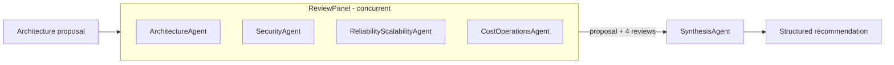

# AI Architecture Review Board

Demo for the .NET event session **"Agentic .NET in Action: Microsoft Agent Framework, Aspire and Foundry"**.

You submit a software architecture proposal. Four specialist AI agents review it **concurrently**. A fifth agent, the **Synthesis Agent**, then merges their findings **sequentially** into one structured recommendation.

| | |
| --- | --- |
| Runtime | .NET 11 |
| Agents and workflows | [Microsoft Agent Framework](https://learn.microsoft.com/agent-framework/) (MAF) |
| Orchestration and observability | .NET Aspire (dashboard, OpenTelemetry) |
| Models | Azure OpenAI / Microsoft Foundry (default deployment `gpt-6-luna`) |
| Dev UI | MAF DevUI |

> The solution is intentionally small. There is no RAG, no tools, no external integrations and no custom UI. The goal is to show the agent and workflow concepts clearly.

## What you will see in the demo

1. Four narrow, single-purpose agents (about 5 lines of instructions each).
2. A **concurrent** workflow that fans the proposal out to all four specialists.
3. A **sequential** workflow that chains the concurrent panel into the Synthesis Agent.
4. A workflow exposed as an agent, so workflows can be nested and composed.
5. DevUI to run and inspect agents and workflows visually.
6. Aspire dashboard traces for every chat call and agent step.

## Architecture



`ArchitectureReviewBoard` is the entry point. It is a sequential workflow: `ReviewPanel` first, then `SynthesisAgent`.

### Agents

| Agent | Scope |
| --- | --- |
| `ArchitectureAgent` | Service boundaries, coupling, data ownership, integration patterns |
| `SecurityAgent` | Identity, network exposure, data protection, secrets, compliance |
| `ReliabilityScalabilityAgent` | Availability, failure modes, scaling, disaster recovery |
| `CostOperationsAgent` | Cost drivers, operational complexity, observability, team readiness |
| `SynthesisAgent` | Merges the four reviews and resolves conflicts |

Each specialist stays inside its own scope and answers with **Strengths, Concerns, Recommendations** in under 250 words. This keeps the reviews focused and the outputs easy to compare.

### Workflows

| Workflow | Pattern | Built with |
| --- | --- | --- |
| `ReviewPanel` | Concurrent (fan-out / fan-in) | `AgentWorkflowBuilder.BuildConcurrent` |
| `ArchitectureReviewBoard` | Sequential | `AgentWorkflowBuilder.BuildSequential(ReviewPanel, SynthesisAgent)` |

The default concurrent aggregator returns the user message plus one assistant message per specialist. `SynthesisAgent` therefore sees the proposal and all four reviews as conversation history.

Workflows exchange typed JSON between agents. The agents you pick in DevUI (`ArchitectureAgent`, `ReviewPanel`, `SynthesisAgent`, `ArchitectureReviewBoard`, ...) wrap them with the input guard and render markdown. The raw JSON workflows (`ReviewPanelWorkflow`, `ReviewBoardWorkflow`) stay available for the graph view.

### Synthesis output

The Synthesis Agent always returns these sections:

- Proposed Design
- Rationale
- Trade-offs
- Risks
- Mitigations
- Open Questions

When specialists disagree, it states the conflict and explains how and why it resolved it.

## Solution layout

```text
ArchitectureReviewer/
├── ArchitectureReviewer.slnx
├── ArchitectureReviewer.AppHost/         Aspire orchestration
├── ArchitectureReviewer.ApiService/      Agents, workflows, DevUI, OpenAI-compatible endpoints
└── ArchitectureReviewer.ServiceDefaults/ OpenTelemetry, health checks, service discovery, resilience
```

| Project | Responsibility |
| --- | --- |
| `ApiService` | All agent wiring lives in [Program.cs](ArchitectureReviewer/ArchitectureReviewer.ApiService/Program.cs). It exposes DevUI, dedicated Chat Completions endpoints for `ArchitectureAgent` and `ArchitectureReviewBoard`, and the OpenAI Responses and Conversations endpoints. Sample requests are in the `.http` file next to it. |
| `AppHost` | Starts `apiservice`, forwards the Azure OpenAI settings to it and adds a **DevUI Visual App** link in the Aspire dashboard. See [AppHost.cs](ArchitectureReviewer/ArchitectureReviewer.AppHost/AppHost.cs). |
| `ServiceDefaults` | Shared telemetry and resilience setup. See [Extensions.cs](ArchitectureReviewer/ArchitectureReviewer.ServiceDefaults/Extensions.cs). |

## Key code walkthrough

### One shared chat client

All agents share a single `IChatClient` singleton with OpenTelemetry enabled.

```csharp
IChatClient chatClient = new AzureOpenAIClient(new Uri(endpoint), new AzureCliCredential())
    .GetChatClient(deploymentName)
    .AsIChatClient()
    .AsBuilder()
    .UseOpenTelemetry(configure: c => c.EnableSensitiveData = true)
    .Build();
builder.Services.AddSingleton(chatClient);
```

### Registering a specialist

Agents are registered with `AddAIAgent`, so DevUI and the workflows can resolve them by name.

```csharp
builder.AddAIAgent(agentName, (sp, name) => new ChatClientAgent(
    chatClient: sp.GetRequiredService<IChatClient>(),
    instructions: instructions,
    name: name,
    description: description,
    ...));
```

### Concurrent panel exposed as an agent

```csharp
builder.AddWorkflow("ReviewPanel", (sp, name) =>
{
    var specialists = new[] { "ArchitectureAgent", "SecurityAgent", "ReliabilityScalabilityAgent", "CostOperationsAgent" }
        .Select(n => sp.GetRequiredKeyedService<AIAgent>(n));

    return AgentWorkflowBuilder.BuildConcurrent(name, specialists);
}).AddAsAIAgent();
```

### Sequential board

```csharp
builder.AddWorkflow("ArchitectureReviewBoard", (sp, name) =>
{
    var reviewPanel = sp.GetRequiredKeyedService<AIAgent>("ReviewPanel");
    var synthesisAgent = sp.GetRequiredKeyedService<AIAgent>("SynthesisAgent");

    return AgentWorkflowBuilder.BuildSequential(name, reviewPanel, synthesisAgent);
}).AddAsAIAgent();
```

### Telemetry and resilience

In `ServiceDefaults`:

- Tracing adds the `*Microsoft.Extensions.AI` and `*Microsoft.Extensions.Agents*` activity sources, so chat and agent spans appear in the Aspire dashboard.
- The HTTP resilience handler uses LLM-friendly timeouts (5 min total, 3 min per attempt, 2 retries). The default 10 second timeout would cut off the agent calls.

## Prerequisites

- [.NET 11 SDK](https://dotnet.microsoft.com/download)
- [Aspire](https://aspire.dev) tooling (the AppHost uses `Aspire.AppHost.Sdk` 13.6.4)
- [Azure CLI](https://learn.microsoft.com/cli/azure/install-azure-cli), signed in with `az login`
- An Azure OpenAI or Microsoft Foundry resource with a chat model deployment (default name `gpt-6-luna`)
- Your identity needs access to the model, for example the **Cognitive Services OpenAI User** role

## Configuration

| Setting | Required | Default | Description |
| --- | --- | --- | --- |
| `AZURE_OPENAI_ENDPOINT` | Yes | none | Endpoint of your Azure OpenAI / Foundry resource |
| `AZURE_OPENAI_DEPLOYMENT_NAME` | No | `gpt-6-luna` | Model deployment name |

The AppHost reads both values from its configuration and forwards them to `apiservice`. Keep your endpoint out of source control by using user secrets:

```powershell
cd ArchitectureReviewer/ArchitectureReviewer.AppHost
dotnet user-secrets set "AZURE_OPENAI_ENDPOINT" "https://<your-resource>.services.ai.azure.com"
dotnet user-secrets set "AZURE_OPENAI_DEPLOYMENT_NAME" "gpt-6-luna"
```

Alternatively, set them as environment variables or in `appsettings.Development.json` (do not commit real values).

> Authentication uses `AzureCliCredential`. This is for **local development only** and requires `az login`.

## Run it

```powershell
az login
dotnet build ArchitectureReviewer/ArchitectureReviewer.slnx
dotnet run --project ArchitectureReviewer/ArchitectureReviewer.AppHost
```

Then, in the Aspire dashboard:

1. Open the `apiservice` resource.
2. Click the **DevUI Visual App** link (the `/devui` path).
3. Pick `ArchitectureReviewBoard` and paste the sample proposal below.

### Sample proposal

> Migrate our monolithic e-commerce platform to microservices on AKS with an event-driven backbone on Azure Service Bus, a separate PostgreSQL database per service, and a single Azure Front Door entry point across two regions.

### Expected result

- The four specialists run in parallel and each returns Strengths, Concerns and Recommendations.
- The Synthesis Agent runs after them and returns the six sections listed above.
- In the Aspire dashboard **Traces** view, you can see the concurrent chat calls and the final synthesis call.

Try running `ReviewPanel` or a single specialist from DevUI to compare the individual outputs.

## HTTP endpoints

`apiservice` exposes:

| Path | Purpose |
| --- | --- |
| `/devui` | DevUI for exploring and running agents and workflows |
| `POST /agents/architecture/v1/chat/completions` | OpenAI Chat Completions endpoint for `ArchitectureAgent` (single specialist) |
| `POST /agents/review-board/v1/chat/completions` | OpenAI Chat Completions endpoint for `ArchitectureReviewBoard` (full review plus synthesis) |
| OpenAI Responses and Conversations | OpenAI-compatible APIs mapped with `MapOpenAIResponses` and `MapOpenAIConversations` |
| `/health`, `/alive` | Health checks (Development only) |

The two dedicated endpoints are mapped in [Program.cs](ArchitectureReviewer/ArchitectureReviewer.ApiService/Program.cs) with `MapOpenAIChatCompletions`:

```csharp
app.MapOpenAIChatCompletions(architectureAgent, "/agents/architecture/v1/chat/completions");
app.MapOpenAIChatCompletions(reviewBoard, "/agents/review-board/v1/chat/completions");
```

They accept standard Chat Completions requests (including `"stream": true`), so any OpenAI client can call them. The path selects the agent. The `model` field selects the Azure OpenAI deployment (default `gpt-6-luna`); other names must be listed in `AZURE_OPENAI_ALLOWED_DEPLOYMENTS` (comma-separated) or the request returns 400.

### Try the endpoints

Open [ArchitectureReviewer.ApiService.http](ArchitectureReviewer/ArchitectureReviewer.ApiService/ArchitectureReviewer.ApiService.http) in VS Code (REST Client or the built-in HTTP support) with the AppHost or `ApiService` running. It contains ready-made requests for:

- the health check,
- `ArchitectureAgent`,
- `ArchitectureReviewBoard`, with and without streaming.

The `@ApiService_HostAddress` variable defaults to `http://localhost:5344` (the `ApiService` launch profile). When you start through Aspire, copy the `apiservice` URL from the dashboard instead.

Example with `curl`:

```powershell
curl -X POST http://localhost:5344/agents/review-board/v1/chat/completions `
  -H "Content-Type: application/json" `
  -d '{"model":"gpt-6-luna","messages":[{"role":"user","content":"Migrate our monolith to microservices on AKS."}]}'
```

### Calling a deployed instance

Outside Development the endpoints require a Microsoft Entra bearer token. Get one with the Azure CLI, replacing `<client-id>` with the application (client) ID of the API's app registration (the `AzureAd:Audience` value is `api://<client-id>`):

```powershell
$token = az account get-access-token --scope "api://<client-id>/.default" --query accessToken -o tsv
```

Then pass it in the `Authorization` header:

```powershell
curl -X POST https://<your-apiservice-url>/agents/review-board/v1/chat/completions `
  -H "Authorization: Bearer $token" `
  -H "Content-Type: application/json" `
  -d '{"model":"gpt-6-luna","messages":[{"role":"user","content":"Migrate our monolith to microservices on AKS."}]}'
```

## Talking points for the session

- **Narrow agents beat generic ones.** Short, single-purpose instructions give more predictable results.
- **Workflows are agents.** `AddAsAIAgent()` lets you nest a workflow inside another workflow.
- **Concurrent then sequential.** Fan-out for independent opinions, then a single chair to reconcile them.
- **Observability from day one.** Aspire and OpenTelemetry make agent behavior visible without extra code.
- **DevUI for fast inner loop.** Run and inspect agents without building a UI.

## Notes and limitations

- DevUI is a development tool. Do not expose it in production.
- `Microsoft.Agents.AI.DevUI`, `Hosting` and `Hosting.OpenAI` are prerelease packages. Keep them aligned with the `Microsoft.Agents.AI.OpenAI` version line.
- If composing a concurrent workflow as an agent inside `BuildSequential` fails on other package versions, fall back to an explicit `WorkflowBuilder` graph (fan-out, fan-in aggregator executor, then `SynthesisAgent`).
- Out of scope: RAG, tools, external integrations, custom UI and production hardening.

## Further reading

- [Microsoft Agent Framework documentation](https://learn.microsoft.com/agent-framework/)
- [Aspire documentation](https://aspire.dev)
- [Microsoft Foundry documentation](https://learn.microsoft.com/azure/ai-foundry/)
